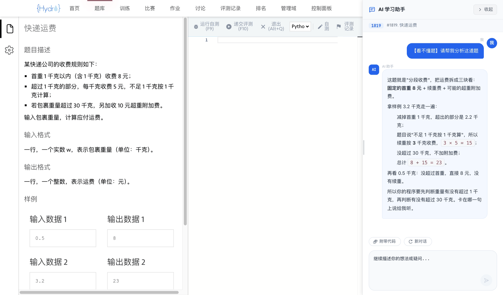
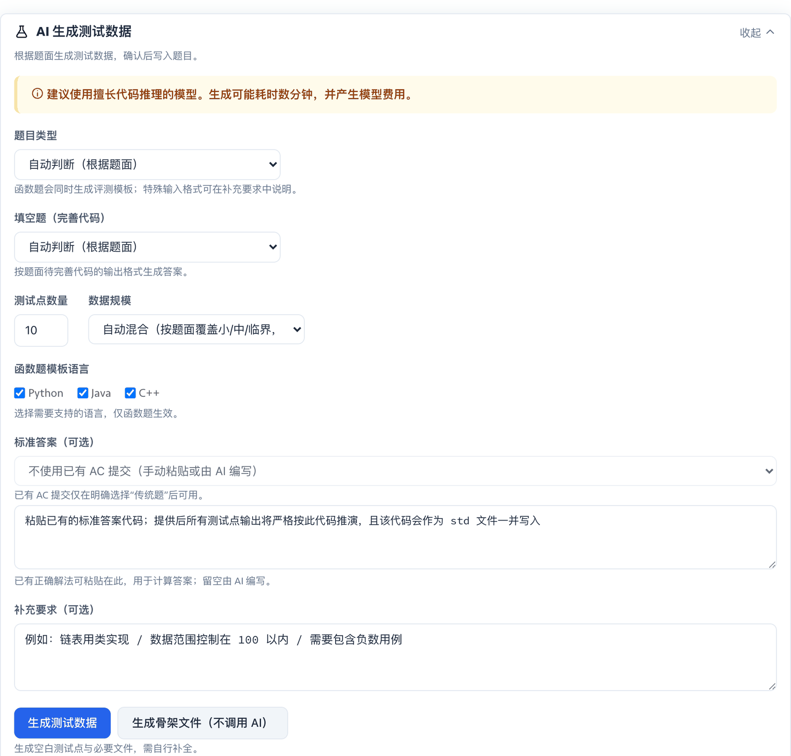
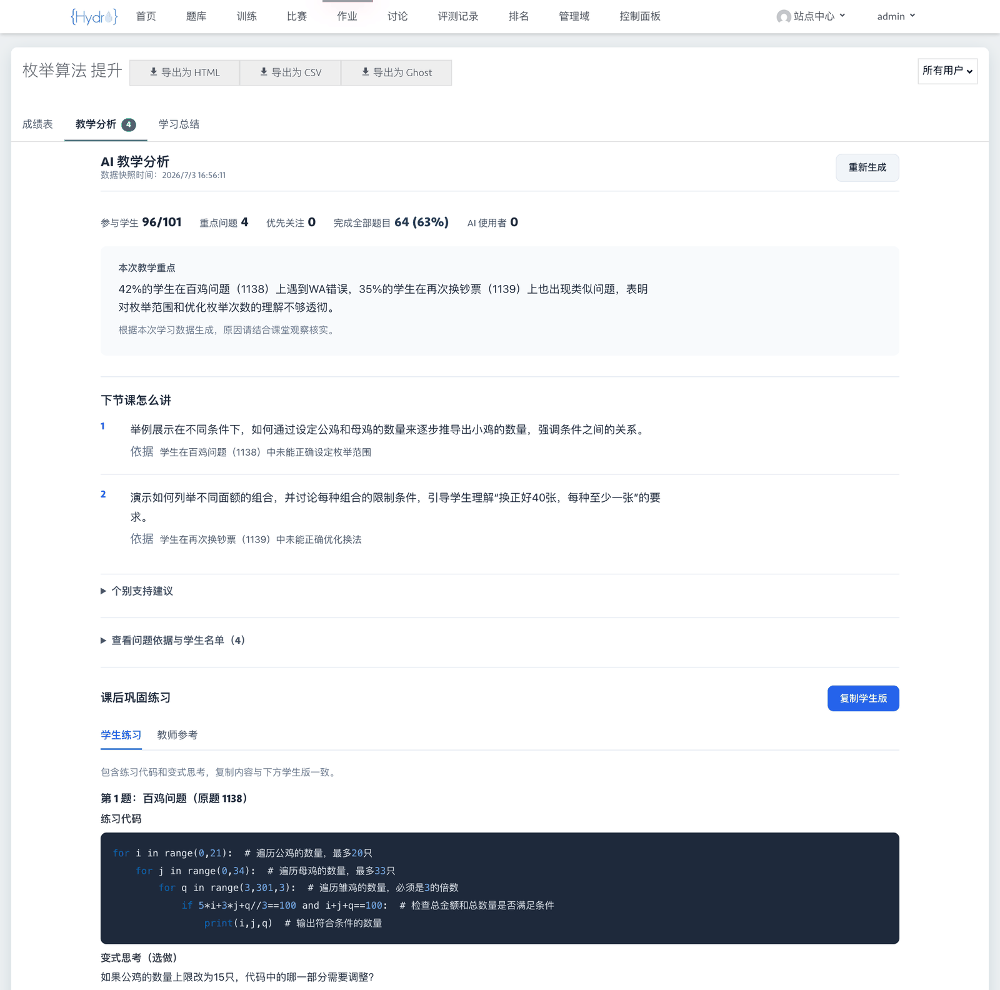
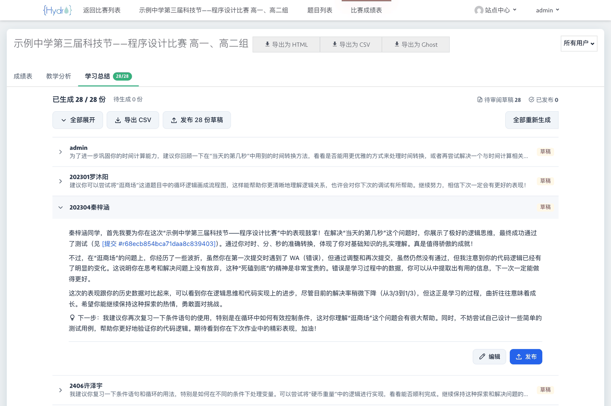
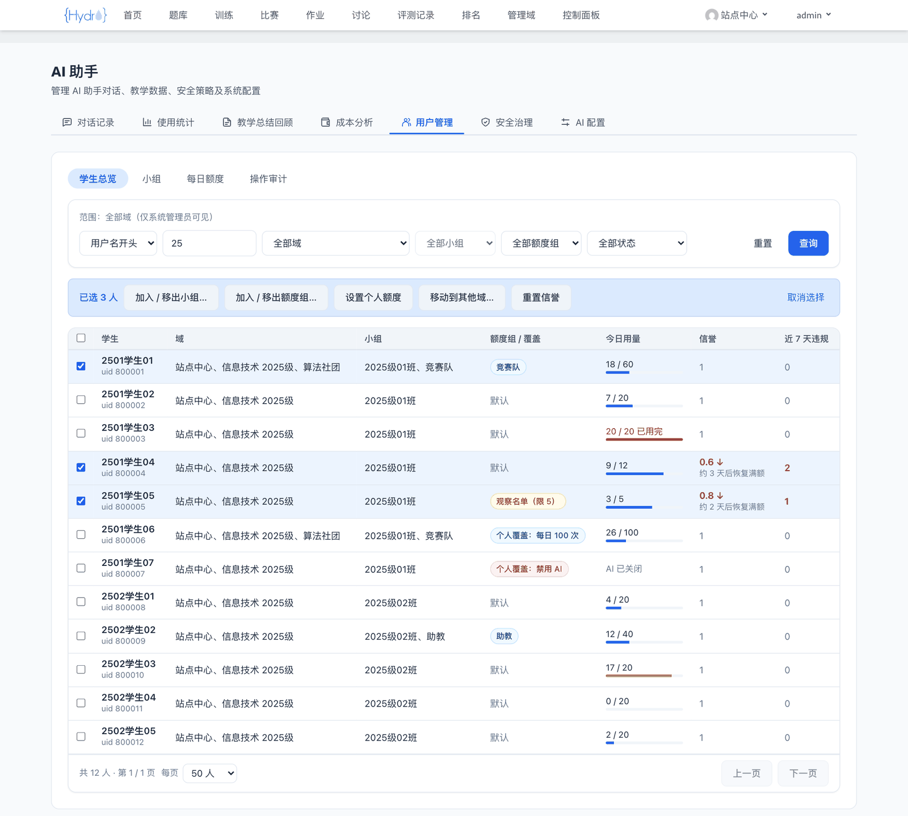
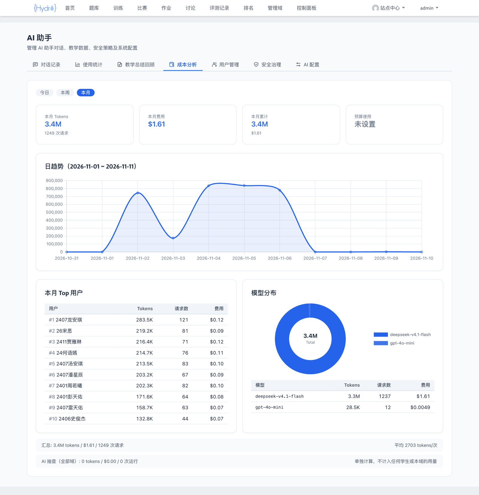

# HydroOJ AI 学习助手

<div align="center">

**中文 | [English](README_en.md)**


</div>

以教学为优先的 [HydroOJ](https://github.com/hydro-dev/Hydro) AI 插件：引导学生思考，不直接给答案。支持中英文界面，兼容 Hydro 4 和 Hydro 5。



## 核心功能

### 学生：会引导、不给答案的 AI 助手

- 在题目页打开 AI 面板，按「看不懂题 / 没思路 / 调试代码 / 代码优化（通过后）」提问，回答实时流式显示。
- AI 结合样例讲思路、指出问题所在，不给出完整代码；提示注入、越狱和偏题会被拦截。
- 在成绩表查看老师发布的个人学习总结。

### 教师：出题、学情分析和讲评

- **AI 生成测试数据**：在题目文件页根据题面生成测试点、评测配置和标程。生成器和标程在判题沙箱中实际运行，经过暴力解对拍、输入校验和样例回归；预览、确认后才写入题目。
- **教学分析**：从全班提交中找出共性问题，给出「下节课怎么讲」的建议和课后巩固练习。
- **批量学习总结**：为每位学生生成个性化总结，审阅草稿后发布给学生。
- **负责老师只读视图**（可选）：小组的负责老师只读查看本组学生的 AI 对话和统计。

<details>
<summary><b>教师端截图</b></summary>







</details>

### 管理员：用户、额度、安全和成本

- **用户管理**：按用户名前缀、正则或名单批量管理 Hydro 小组；跨域转移小组和学生；在学生总览中跨域查看每个学生的小组、额度、用量和信誉。所有成员变更可撤销。
- **每日 AI 额度**：按提问次数计算、跨域合计，可按额度组或个人设置。违规会降低信誉系数和当日额度，之后逐日恢复。
- **安全治理**：多层越狱与提示注入检测、AI 抽查、学生申诉与复核；成员、额度、信誉和开关的变更都留有审计记录。
- **模型与成本**：多个 API 端点自动切换，可为对话、测试数据生成等场景分别指定模型；统计 Token 用量和费用，支持预算上限。

<details>
<summary><b>管理端截图</b></summary>





</details>

## 安装

需要 HydroOJ 4.x 或 5.x。AI 生成测试数据还需要 Hydro 判题沙箱（go-judge）可以访问。

```bash
git clone https://github.com/AltureT/hydro-ai-helper.git   # 或 Gitee 镜像：https://gitee.com/alture/hydro-ai-helper.git
cd hydro-ai-helper
npm install
npm run build:plugin
hydrooj addon add "$(pwd)"
```

为 Hydro 进程设置加密密钥（用于加密保存 API Key，至少 16 个字符），然后重启：

```bash
export ENCRYPTION_KEY="$(openssl rand -base64 24)"
pm2 restart hydrooj --update-env && pm2 save
```

请妥善保存这个密钥。更换密钥会导致已保存的 API Key 无法解密，更换方法见[配置说明](docs/configuration.md)。

访问 `/ai-helper/hello`，返回 JSON 即表示插件已加载。

## 首次配置

以系统管理员登录，进入 **控制面板 → AI 助手**（`/ai-helper`）→「AI 配置」：

1. **添加 API 端点**：填写 API Base URL 和 API Key，点击「获取模型列表」。
2. **选择模型**：勾选要用的模型并拖动排序，首选模型不可用时自动切换到下一个。
3. **场景模型**（可选）：为「测试数据生成」等场景单独指定模型，建议使用最强的模型。
4. 点击「保存配置」，再点击「检查接口连接」确认可用。

之后可以在「AI 配置」页一键更新插件。默认只更新到经过 GPG 签名验证的正式版本。

可选环境变量（更新通道、日志保留天数、测试数据生成参数等）见[配置说明](docs/configuration.md)。

## 遥测与隐私

插件会上报匿名统计数据（安装数、活跃用户数、对话数、功能用量和版本），用于项目徽章和改进开发。上报使用随机 ID，不包含代码、对话内容或任何个人信息，也不保存 IP；只记录由 Cloudflare 粗略推断的国家和省份。关闭方法见[配置说明](docs/configuration.md#关闭遥测)。

## 更新日志与许可证

各版本的改动见 [CHANGELOG.md](CHANGELOG.md)。本项目是 HydroOJ 的第三方插件，以 MIT 许可证发布。欢迎提交 Issue 反馈问题和建议。
