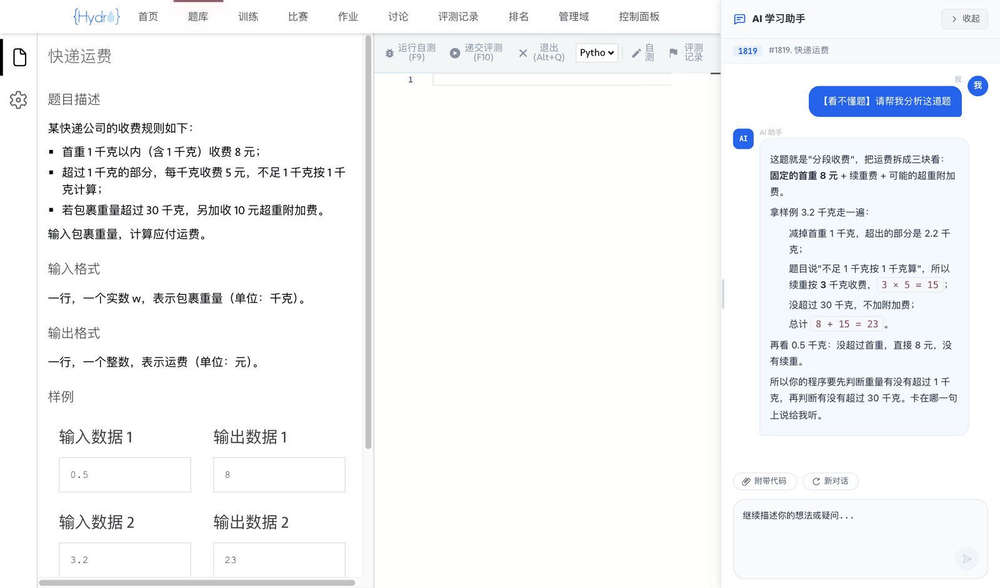
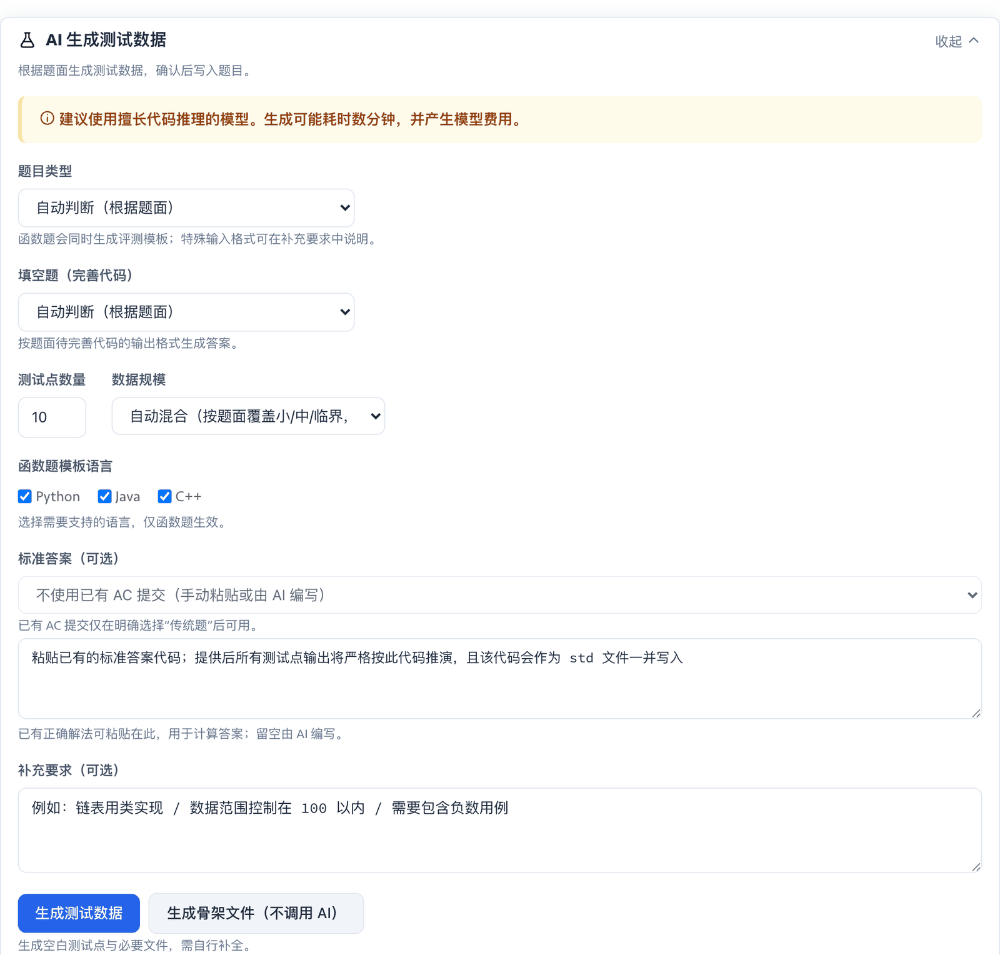
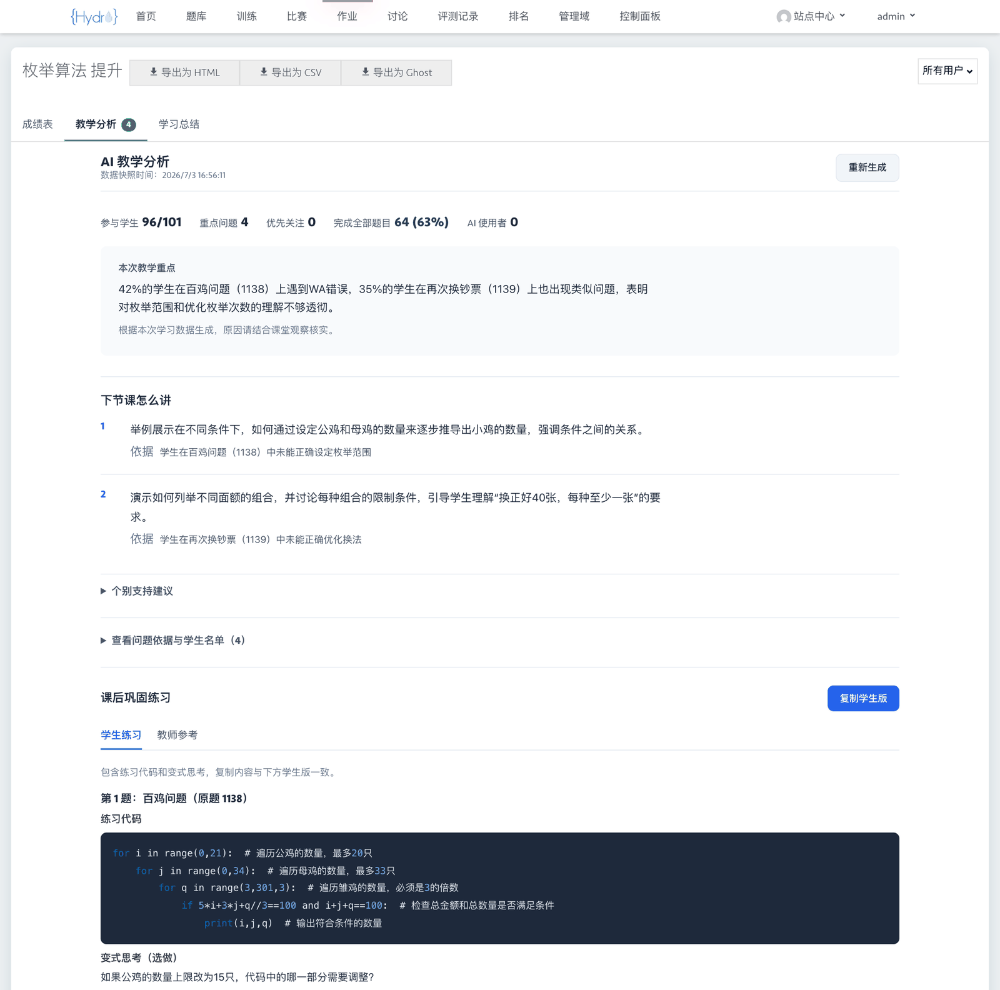
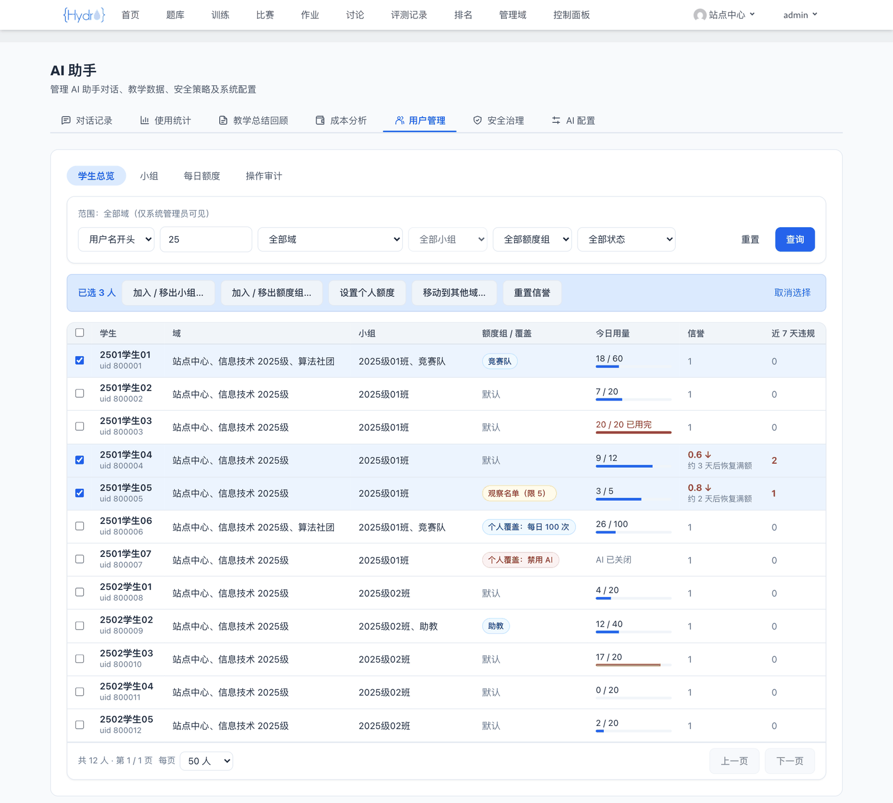
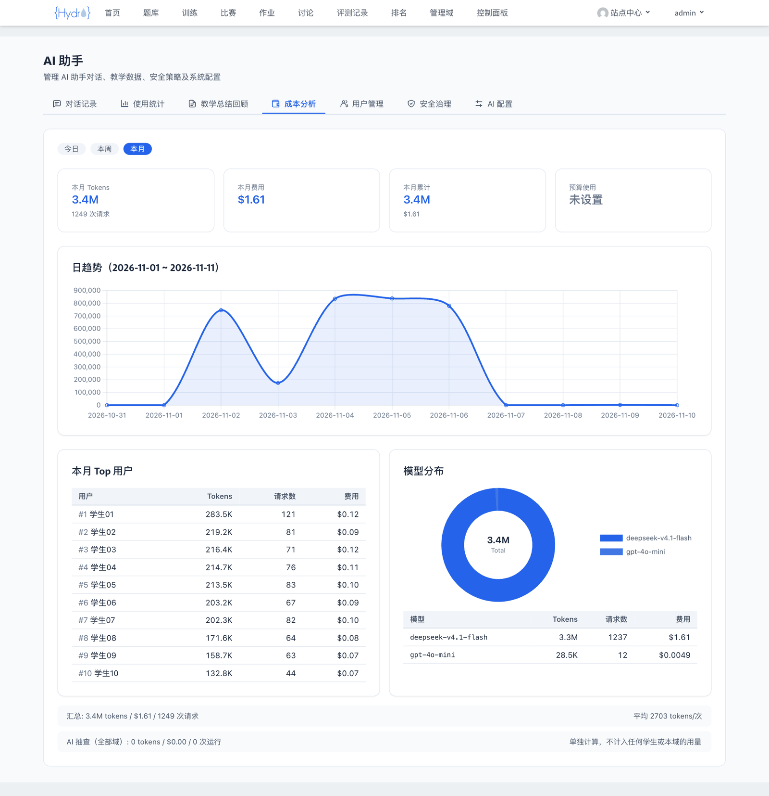

# HydroOJ AI Learning Assistant

<div align="center">

**[中文](README.md) | English**


</div>

A teaching-first AI plugin for [HydroOJ](https://github.com/hydro-dev/Hydro): it guides students to think instead of handing out answers. Chinese and English UI, works with Hydro 4 and Hydro 5.



> Screenshots show the Chinese UI with sample data.

## Features

### Students: an AI tutor that guides instead of answering

- Open the AI panel on a problem page and ask by type: Don't understand / No idea / Debug code / Optimize code (after AC). Replies stream in real time.
- The AI explains ideas with the samples and points at what is wrong, without giving complete code. Prompt injection, jailbreak attempts and off-topic chat are blocked.
- Read the personal learning summary the teacher published on the scoreboard.

### Teachers: problem setting, class insight and review

- **AI test data generation**: on the problem files page, generate test cases, judge config and a reference solution from the statement. The generator and solution actually run in the judge sandbox and are checked by brute-force comparison, input validation and sample regression. Nothing is written until you preview and confirm.
- **Teaching analysis**: finds common problems across the class's submissions and suggests what to cover next lesson, plus follow-up exercises.
- **Batch learning summaries**: a personal summary for every student, published after you review the drafts.
- **Read-only view for group teachers** (optional): a group's teacher can read their students' AI conversations and stats.

<details>
<summary><b>Teacher screenshots</b></summary>





</details>

### Admins: users, quotas, safety and cost

- **User management**: batch-manage Hydro groups by username prefix, regex or list; move groups and students between domains; see every student's groups, quota, usage and credit across domains in the student overview. Every membership change can be undone.
- **Daily AI quota**: counted per question and summed across domains, set by quota group or per person. Violations lower a student's credit and daily quota, which then recover day by day.
- **Safety**: layered jailbreak and prompt-injection detection, AI spot checks, student appeals and review; changes to membership, quotas, credit and settings are audited.
- **Models and cost**: multiple API endpoints with automatic failover, a separate model per scenario (chat, test data generation, …), token and cost tracking with budget limits.

<details>
<summary><b>Admin screenshots</b></summary>





</details>

## Installation

Requires HydroOJ 4.x or 5.x. AI test data generation also needs the Hydro judge sandbox (go-judge) to be reachable.

```bash
git clone https://github.com/AltureT/hydro-ai-helper.git   # or the Gitee mirror: https://gitee.com/alture/hydro-ai-helper.git
cd hydro-ai-helper
npm install
npm run build:plugin
hydrooj addon add "$(pwd)"
```

Give the Hydro process an encryption key (used to encrypt stored API keys, at least 16 characters), then restart:

```bash
export ENCRYPTION_KEY="$(openssl rand -base64 24)"
pm2 restart hydrooj --update-env && pm2 save
```

Keep this key safe. Changing it makes stored API keys unreadable; see [Configuration](docs/configuration_en.md) for how to rotate it.

Open `/ai-helper/hello`: a JSON response means the plugin is loaded.

## First-time setup

Sign in as a system administrator and go to **Control Panel → AI Assistant** (`/ai-helper`) → "AI Config":

1. **Add an API endpoint**: enter the API base URL and API key, then click "Fetch Model List".
2. **Choose models**: tick the models to use and drag to order them. If the first one is unavailable, the next is used.
3. **Scenario models** (optional): pick a separate model for scenarios such as test data generation. Use your strongest model there.
4. Click "Save Configuration", then "Check API connection".

You can update the plugin from the "AI Config" page later. By default it only installs GPG-signed releases.

Optional environment variables (update channel, log retention, test data generation settings, …) are listed in [Configuration](docs/configuration_en.md).

## Telemetry and privacy

The plugin reports anonymous statistics (installs, active users, conversation count, feature usage and version) for the project badges and to guide development. Reports use a random ID and contain no code, conversation content or personal data, and no IP address is stored; only the country and province that Cloudflare roughly infers are recorded. See [Configuration](docs/configuration_en.md#disabling-telemetry) to turn it off.

## Changelog and license

See [CHANGELOG.md](CHANGELOG.md) for what changed in each version. This is a third-party HydroOJ plugin released under the MIT License. Issues with bugs and suggestions are welcome.
